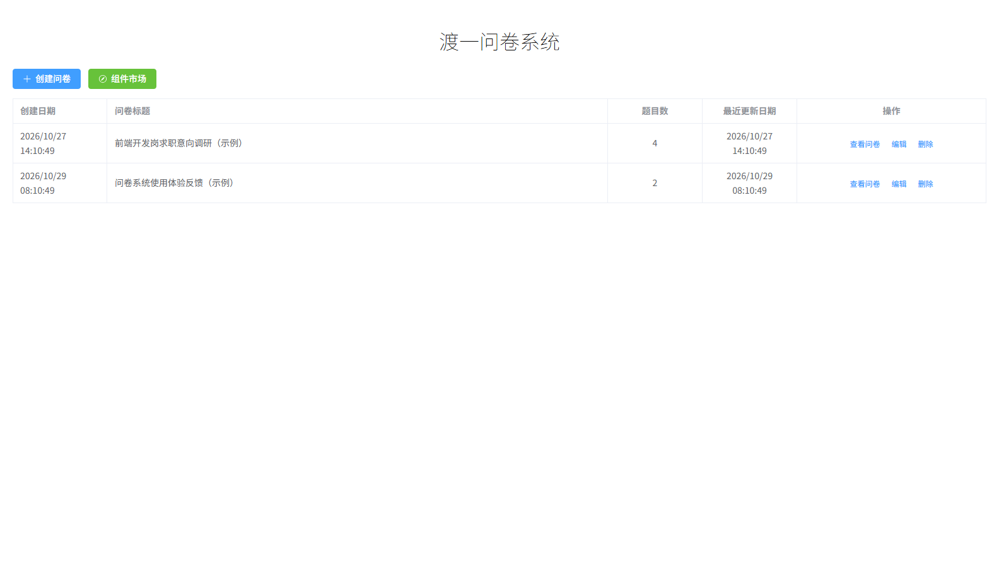
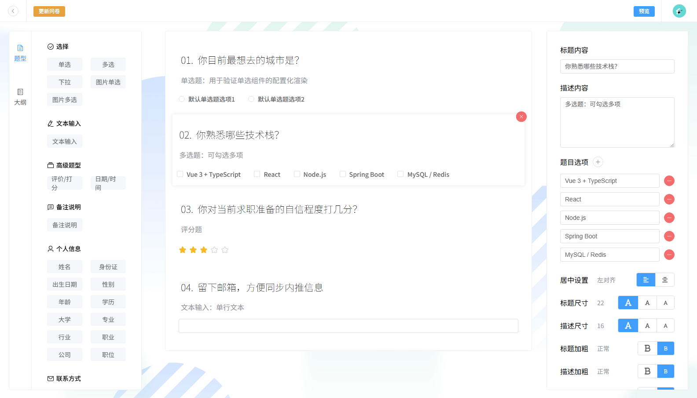
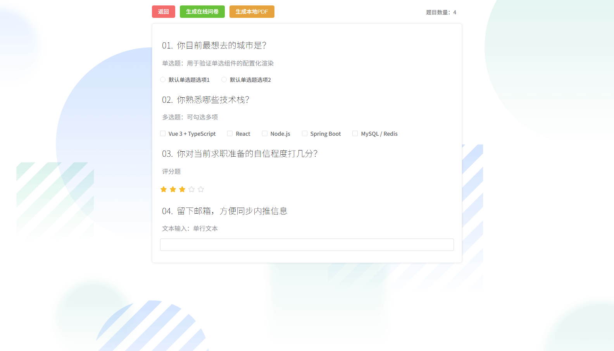
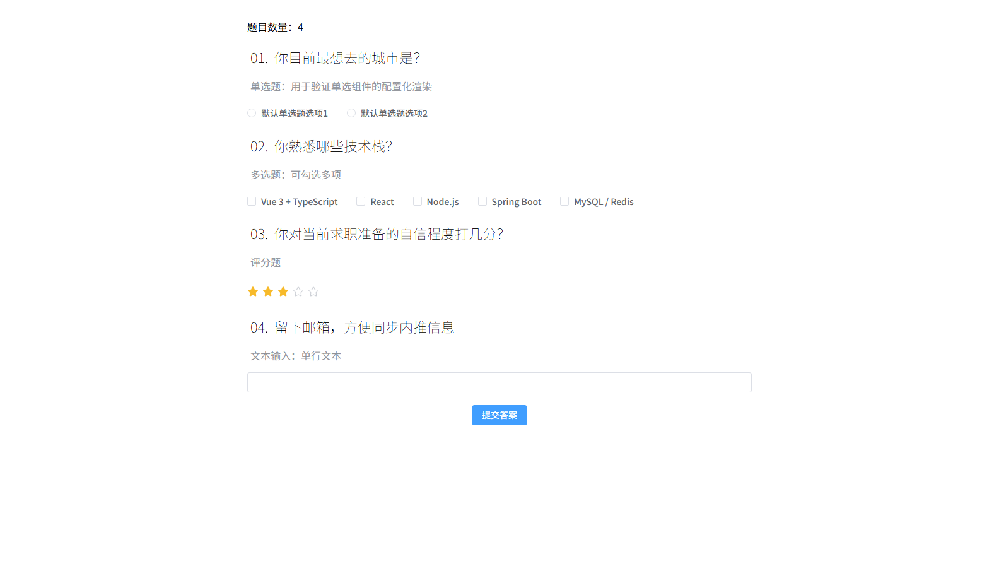

# 低代码问卷搭建平台

一个可视化问卷编辑器：左侧组件库拖到画布，右侧实时改属性，支持 26 种题型预设（由 9 个基础组件组合而成）、离线存储、一键导出 PDF 与生成在线答题链接。

> 在线演示：**（部署后替换成链接）**
> 演示站首屏带两份「（示例）」问卷，点开即可体验完整编辑流程。



---

## 截图

| 可视化编辑器（三栏 + 属性面板） | 问卷预览 / 导出 |
|---|---|
|  |  |

| 在线答题页 |
|---|
|  |

---

## 功能

- **26 种题型预设**：单选 / 多选 / 下拉 / 图片单选 / 图片多选 / 文本输入 / 评分 / 日期时间 / 备注说明，以及一整组「个人信息」预置题型（姓名、身份证、学历、职业等）。底层只有 **9 个基础组件**，其余预设靠不同的配置组合出来——这也是「加题型很容易」的原因
- **三栏编辑器**：左组件目录、中画布、右属性面板；组件目录与画布通过 `vuedraggable` 拖拽排序，大纲视图与画布双向联动
- **数据驱动的属性面板**：每道题自带一份 `status` 描述，面板按描述渲染出标题、描述、选项、对齐、字号、加粗、斜体、颜色等 15 类编辑控件——加新题型不用改面板代码
- **离线可用**：问卷存在浏览器 IndexedDB 里，关掉页面再打开数据还在，不依赖网络
- **导出 PDF**：走浏览器打印通道，导出前按题型白名单校验，自动隐藏操作按钮与边框阴影
- **在线答题**：生成唯一链接，答卷分发与回收（需配合后端）
- **演示模式**：后端不可用时自动降级为本地存储，静态部署也能完整演示「发布 → 答题」流程

---

## 技术栈

**前端**

| 类别 | 选型 |
|---|---|
| 框架 | Vue 3.5（`<script setup>` + 组合式 API） |
| 语言 | TypeScript |
| 构建 | Vite 5 |
| 状态 | Pinia 2 |
| UI | Element Plus 2.8 + Font Awesome |
| 拖拽 | vuedraggable 4 |
| 本地存储 | Dexie 4（IndexedDB 封装） |
| 路由 | Vue Router 4（HTML5 History 模式） |

**后端**

Express 4 + body-parser + multer，数据落盘为 JSON 文件（`server/data/`），图片存 `server/uploads/`。

---

## 目录结构

```
.
├── survey/                     # 前端
│   ├── src/
│   │   ├── components/
│   │   │   ├── SurveyComs/     # 题型组件（Materials）+ 属性编辑控件（EditItems）
│   │   │   └── Editor/         # 编辑器通用组件
│   │   ├── configs/
│   │   │   ├── componentMap.ts       # 题型名 → 组件 的映射表
│   │   │   ├── SurveyGroupConfig.ts  # 组件库分组
│   │   │   └── defaultStatus/        # 每种题型的默认配置工厂
│   │   ├── stores/             # useEditor / useMaterial / useStore / dispatch
│   │   ├── db/                 # Dexie 实例、增删改查、示例数据预置
│   │   ├── views/              # 首页 / 编辑器 / 预览 / 答题
│   │   ├── types/              # 类型定义（含题型白名单类型守卫）
│   │   └── utils/              # 组件还原、演示模式存储等
│   ├── public/
│   ├── edgeone.json            # EdgeOne Makers 部署配置（SPA 回退）
│   └── vite.config.ts
├── server/                     # 后端
│   ├── server.js
│   └── _verify_persist.mjs     # 持久化验证脚本（7 项断言）
├── docs/screenshots/
├── 部署说明.md
└── README.md
```

---

## 本地运行

```bash
# 后端（可选，不起也能用前端全部编辑功能）
cd server
npm install
node server.js          # 默认 3000 端口，可用 PORT 环境变量改

# 前端
cd survey
npm install
npm run dev             # 默认 5173 端口，已配好 /api 代理
```

构建产物：

```bash
cd survey
npx vite build          # 产物在 survey/dist/
```

> `npm run build` 会先跑 `vue-tsc` 类型检查，类型报错会中断构建；
> 急着打包时用 `npx vite build` 跳过检查，产物一样。

---

## 几个实现要点

面试容易被追问的地方，这里先写清楚。

### 1. 题型如何做到「加一个组件只改一处」

每种题型是一个工厂函数（`configs/defaultStatus/*.ts`），返回 `{ type, name, id, status }`：

- `type` 是真正的 Vue 组件（`markRaw` 包过）
- `name` 是字符串标识，如 `'single-select'`
- `status` 是这份题目的全部可配置项，每一项自带 `editCom`（用哪个属性编辑器渲染它）

画布上 `<component :is="element.type">` 直接渲染，属性面板按 `status` 的 key 遍历渲染。
新增题型只需要：写组件 → 写工厂 → 在 `componentMap` 注册，**画布和属性面板都不用动**。

### 2. 双 Store + 统一调度

编辑器（`useEditor`）和组件市场（`useMaterial`）共用一套 actions（`stores/actions.ts`），
由 `dispatch` 统一调度，`useStore` 根据 `localStorage.activeView` 决定返回哪个实例。
所以「在组件市场里试玩一个题型」和「在编辑器里编辑一道题」走的是同一套逻辑，不用写两遍。

### 3. 存进 IndexedDB 时组件引用会丢，怎么还原

`com.type` 和 `status[*].editCom` 都是 Vue 组件对象，**IndexedDB 的结构化克隆存不了函数**，
直接存会抛 `DataCloneError`。

处理方式：落库前 `JSON.parse(JSON.stringify(coms))` 把组件字段丢掉，只留 `name` 字符串；
读取时 `restoreComponentStatus()` 按 `name` 从 `componentMap` 把组件重新挂回去。

这个方法有个副作用要知道：`type` 会被序列化成 `{}` 而不是消失，所以还原时必须无条件覆盖。

### 4. 导出 PDF 走的是打印，不是截图

导出前先遍历所有题型，用类型守卫 `isUseForPDF()` 校验是否在 PDF 白名单内，
有不合规的就提示移除；然后 `window.print()`，靠 `@media print` 隐藏操作区和边框阴影。

比 canvas 截图方案的好处：文字是矢量的，可选中、可搜索、文件小。
（注意：`package.json` 里的 `html2canvas` / `jspdf` 是早期尝试留下的未使用依赖，
实际导出没有用它们。）

### 5. 演示模式降级

纯静态部署时没有后端，`/api/*` 会 404。三处都做了降级：

- 图片上传失败 → 转 base64 存进问卷数据
- 发布问卷失败 → 写 localStorage，答题页读不到后端时回落读本地
- 答题页加载失败 → 显示明确提示，而不是白屏

---

## 已知限制

- **演示模式下分享链接仅本机可打开**：数据存在生成它的那个浏览器的 localStorage 里。要让链接对所有人有效，需要部署 `server/`。
- **后端是轻量实现**：JSON 文件存储，适合小规模分发，不是高并发方案。
- **无用户体系**：没有登录注册，问卷归属靠浏览器本地数据。

---

## 部署

见 [部署说明.md](部署说明.md)。已在 `survey/edgeone.json` 备好 EdgeOne Makers 的 SPA 回退配置，
连接 Git 仓库后根目录填 `survey`、构建命令 `npx vite build`、输出目录 `dist` 即可。
